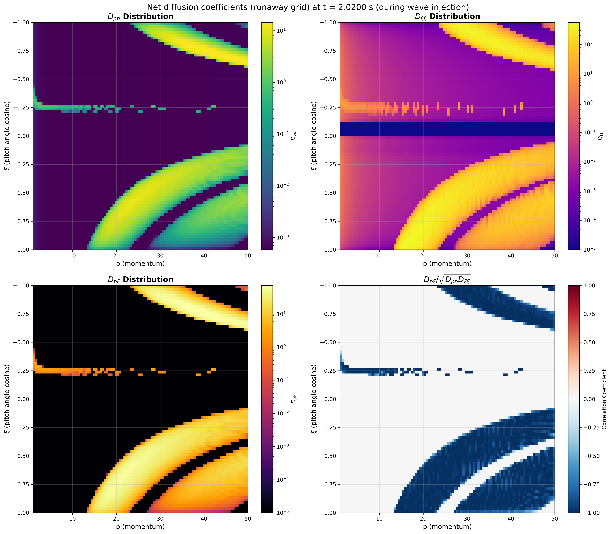
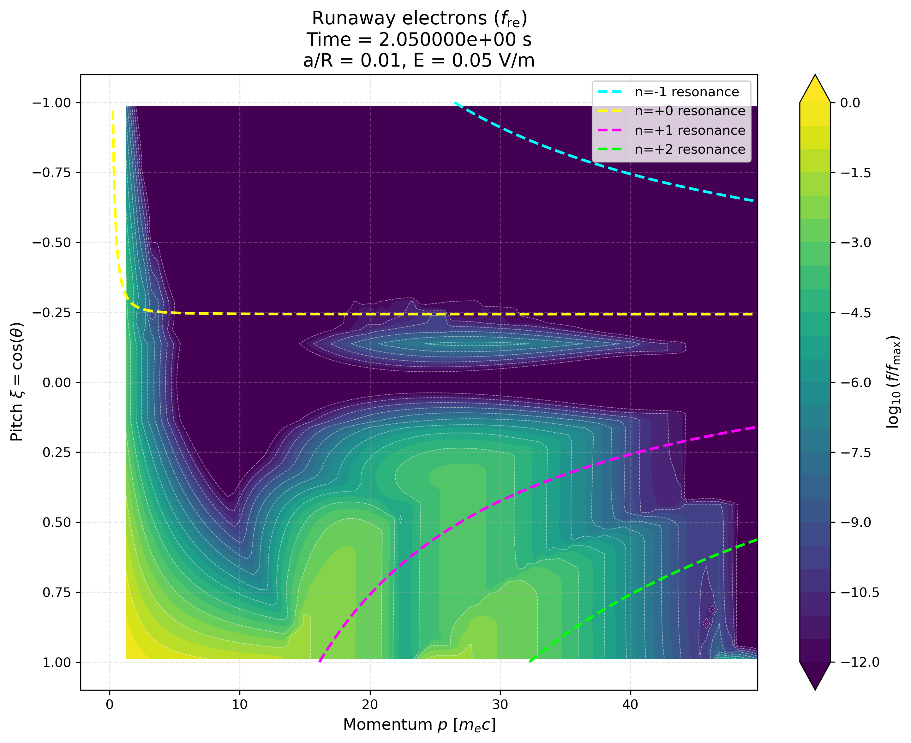
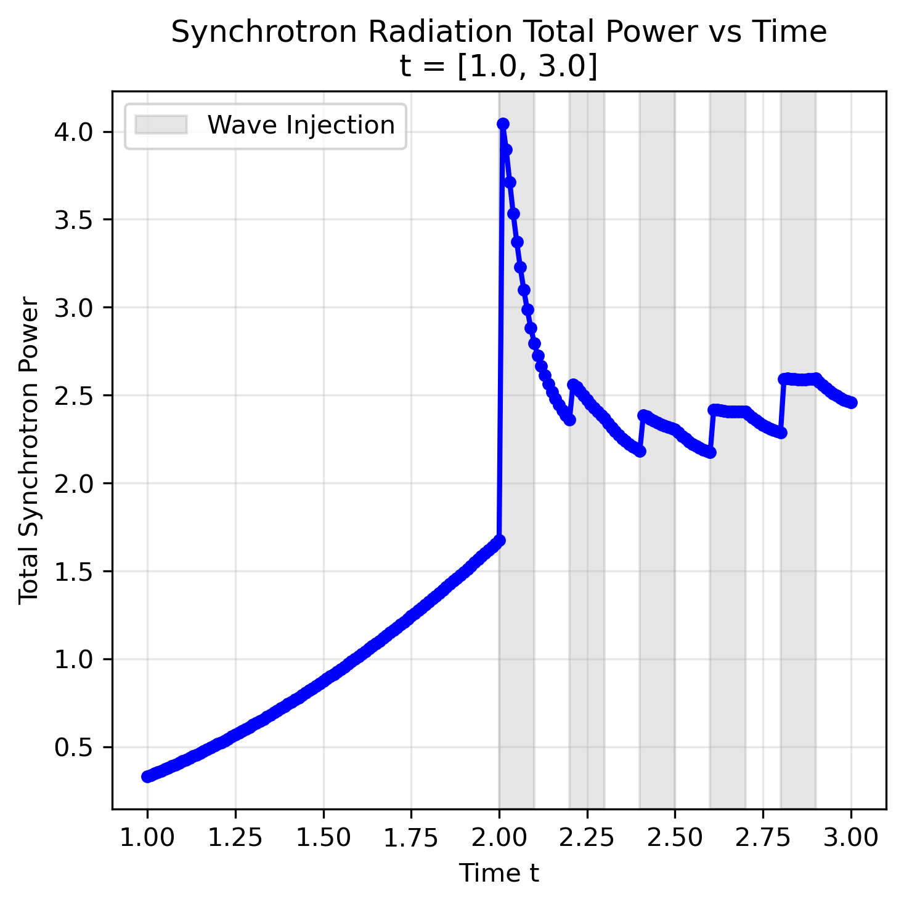

# Runaway Electron Simulation with Whistler Wave Quasilinear Diffusion

This directory contains a complete workflow for simulating avalanche runaway electron generation in DREAM with kinetic models, **including quasilinear diffusion from externally injected whistler waves**, plus post-processing of the kinetic output into a synchrotron radiation signal with a SOFT Green's function.

## Directory Structure

```
avalanche_whistler/
├── scripts/                    # Python scripts and shell scripts
│   ├── run_DIIID_fre.sh                   # Main execution script (simulation + post-processing)
│   ├── run_dream_green.sh                 # Synchrotron radiation pipeline (SOFT Green's function)
│   ├── generate_with_fre.py               # Baseline simulation (no waves)
│   ├── generate_with_fre_whistler.py      # ⭐ Whistler wave simulation
│   ├── plot_f.py                          # Distribution functions (p-xi contours + 1D spectra)
│   ├── plot_nre.py                        # Runaway density & growth rates
│   ├── plot_ql_diffusion_coefficients.py  # Quasilinear diffusion coefficient visualization
│   ├── dream_green_processor.py           # Green's function × f_re batch processor
│   ├── dream_se_power.py                  # Synchrotron radiation total power
│   ├── dump_hdf5_structure.py             # View quasilinear settings
│   ├── compare_dxixi_estimate.py          # Estimate diffusion time
├── docs/                       # Images embedded in this README
├── outputs/                    # Simulation output files (HDF5)
└── figures/                    # Generated plots and figures (PNG)
```


### Run with Whistler Waves 

**Run the complete workflow with quasilinear diffusion:**
Change path to your directory! Bash command is also in run_DIIID_fre.sh 
```bash
cd /data/zhzhou/DREAM/examples/avalanche_whistler/scripts
PLOT_DIR="../figures_wk40_A4_t3_s2_i0.2_T1000"
DATA_DIR="${PLOT_DIR}/quasilinear_whistler_output.h5"
# Create plot directory if it doesn't exist
if [ ! -d "$PLOT_DIR" ]; then
    mkdir -p "$PLOT_DIR"
    echo "Created directory: $PLOT_DIR"
fi

python generate_with_fre_whistler.py \
    --amplitude 1e4 --a 0.02 --R 1.67 --T 1000 \
    --tMax 2.5 --Nt 2500 --source off \
    --output $DATA_DIR \
    --start-inject-time 2.0 --inject-cycle-duration 0.2 --ramp-time 0.02 \
    --k-min 45 --k-max 60 \
    --ktheta-min 2.3 --ktheta-max 2.5 --Nxi 80 --num-k 40 --Np-hot 50 --Np-re 100
```
### Attension
--amplitude  cannot be set larger than 5e4. Too much amplitude can cause FVM flux non conservation.

### Parameter quick reference

(A) Quick command-line parameters — just edit the values in the call
    below; no need to touch the Python script:

  [Wave injection] (the most important ones)

    --amplitude              Normalized wave amplitude (∝ |E_k|²); D scales linearly with it
    --start-inject-time      Wave injection start time (s)
    --inject-cycle-duration  ON+OFF injection cycle (s, 50% duty cycle)
    --ramp-time              Ramp-up time of each ON cycle (s)

  [Wave spectrum]

    --k-min / --k-max        Wavenumber range (m^-1)
    --ktheta-min / --ktheta-max   Propagation angle range (rad; obtuse = backward)
    --num-k / --num-ktheta   Spectral discretization (number of modes = product)

  [Plasma / geometry]

    --E electric field (V/m)   --n density (m^-3)   --T temperature (eV)
    --B0 magnetic field (T)    --a minor radius (m) --R major radius (m)

  [Grid / time]

    --Np-hot / --Np-re / --Nxi   Momentum and pitch grid points
    --tMax / --Nt                Simulation time (s) / number of time steps

  [Other]

    --source on|off          Kinetic avalanche source switch
    --output                 Output h5 path (recipe is saved next to it)

(B) Hard-coded values that require editing generate_with_fre_whistler.py
    (search for "HARDCODED" in the script to locate them):

    - pMax_hot=1 / pMax_re=50      Momentum grid limits (m_e c)
    - k_main=54.58 / ktheta_main=2.42   Central wavenumber / propagation angle
                                       (quadre_wave_params)
    - harmonic_mode='both'         Harmonic set n ∈ {-2..+2}
    - use_simple_dispersion=False  Full PDRK dispersion (True = simplified debug)
    - pCutAvalanche=2.0            Avalanche cutoff momentum
    - nr=1 and custom radial grid r_f   Number of radial points
    - setNumberOfSaveSteps(Nt//10) Number of saved output frames
    - Collision model / solver / boundary conditions / synchrotron switch, etc.

    NOTE: k_main/ktheta_main in quadre_wave_params are documentation only
    (never read by the settings API). The wave frequency (476 MHz) and
    k_par = -41 m^-1 are NOT inputs either: k_par = k*cos(theta_k) is derived
    per mode in C++, and the frequency follows from the whistler dispersion
    relation evaluated at (k, theta_k) together with B0 and n_e.
    The frequency is determined by the k spectrum.


**Run the whistler-wave simulation followed by all post-processing plots:**
```bash
./run_DIIID_fre.sh
```

This runs `generate_with_fre_whistler.py`, then the consolidated plotting scripts
(`plot_f.py`, `plot_nre.py`, `plot_p_perp_parallel.py`). A commented block at the top
of the script shows how to run the baseline `generate_with_fre.py` instead.

### Visualization

```bash
python plot_f.py --data_dir $DATA_DIR --plot_dir $PLOT_DIR \
    --species f_re \
    --t-min 1.0 --t-max 3.0 --dt 0.01 \
    --time_series 1.5,2.1 \
    --figures all

python plot_f.py --data_dir $DATA_DIR --plot_dir $PLOT_DIR \
    --species f_hot --figures contour,spectra

# Runaway density, growth rate, normalized growth rate vs Rosenbluth 2*(E/Ec-1)
python plot_nre.py --data_dir $DATA_DIR --plot_dir $PLOT_DIR
```

The synchrotron radiation post-processing (SOFT Green's function) is described
in the next section.

## Synchrotron radiation power (SOFT Green's function)


```
generate_with_fre_whistler.py
        │  quasilinear_whistler_output.h5 : f_re(t, r, p, xi)
        ▼
dream_green_processor.py  +  green.mat (from SOFT)
        │  data/green_times_f_timestep_XXXX.h5 : G(p, xi) * f(p, xi, t)
        ▼
dream_se_power.py
        └─ data/synchrotron_total_power.csv
           plots/synchrotron_total_power_vs_time[_wave].png
```

### Where the Green's function comes from

`green.mat` is generated **outside this repository** with SOFT2, using the
`GreenDream` example (`SOFT2/examples/GreenDream`). The relevant part of that
example's `pi` configuration is

```
@Radiation rad { output = green; }
@RadiationOutput green (green) {
    format = 12;
    output = "data/green.mat";
}
```

so the file has SOFT Green's-function format `type = "12"` and must contain
`func`, `param1`, `param1name`, `param2`, `param2name`. It is read with `h5py`,
so it must be the HDF5-based `.mat` written by SOFT (MATLAB v7.3), not a
MATLAB v5 file. `param1name/param2name` may be `p` and `xi`, or `p` and
`thetap`; in the latter case the loader converts `ξ = cos(θ_p)`, re-orders the
axis to ascending `ξ`, and treats angles as degrees if the range extends beyond
`2π`. `func` must be `(len(p), len(xi))`; the transposed layout is also accepted.

The Green's function must match the geometry and detector it was computed for
(the reference example uses `B0 = 1.4 T`, `R = 1.67 m`, `a = 0.67 m`, tangential
HXR camera). Nothing in `examples/avalanche_whistler` recomputes it;
`run_dream_green.sh` only points at an existing `.mat` file.

### Step 1 — Green's function × distribution (`dream_green_processor.py`)

```bash
cd examples/avalanche_whistler/scripts

python dream_green_processor.py \
    ../figures_wk40_A4_t3_s2_i0.2_T1000/quasilinear_whistler_output.h5 \
    /path/to/green.mat \
    ../figures_wk40_A4_t3_s2_i0.2_T1000/green_results \
    --radial-index 0 --dt 0.005 --t-min 2.0 --t-max 3.0
```

Output layout:

```
<output_dir>/
├── data/green_times_f_timestep_0000.h5   # p, xi, result = G*f, time + attributes
└── plots/green_times_f_t_2.0000.png      # G*f, ∫G*f p² dξ, (p_par, p_perp) view
```

The frame index restarts at `0000` on every run, so rerunning into the same
`output_dir` removes the previous run's `green_times_f_timestep_*.h5` and
`green_times_f_t_*.png` first (`--no-clean` keeps them).

### Step 2 — total power vs time (`dream_se_power.py`)

```bash
python dream_se_power.py ../figures_wk40_A4_t3_s2_i0.2_T1000/green_results \
    --t-min 1.0 --t-max 3.0 \
    --wave-intervals "2.0,2.1;2.2,2.3;2.4,2.5;2.6,2.7;2.8,2.9"
```

The total radiated power in each frame is

```
P(t) = 2π ∫∫ (G·f)(p, ξ, t) p² dp dξ
```

evaluated with the trapezoidal rule over `ξ` and then `p`. The absolute scale
therefore inherits both the SOFT Green's-function normalization and the DREAM
`f_re` units: compare the time evolution (and runs processed the same way)
rather than the absolute W values, unless the Green's function has been
calibrated. Unlike the QUADRE version of this script there is no `--p-runaway`
cut, so the integral covers the whole `p` grid stored in the DREAM output.

| Option | Meaning |
|---|---|
| `results_dir` | Output directory of step 1; it must contain `data/` |
| `--t-min`, `--t-max` | Time range for the plot |
| `--wave-intervals` | Wave-injection windows to shade, `"a,b;c,d;..."` |

Outputs (written into the same `results_dir`):

```
data/synchrotron_total_power.csv                 # time,power
plots/synchrotron_total_power_vs_time.png        # without --wave-intervals
plots/synchrotron_total_power_vs_time_wave.png   # with --wave-intervals
```

The terminal output also reports the time range, the min/max/mean power and the
time of the peak. Frames are sorted by the `time` stored in each file (not by
file name) and duplicate times are dropped, so a results directory reused by
several processor runs still gives a monotonic curve.

### One-shot pipeline (`run_dream_green.sh`)

`run_dream_green.sh` is a SLURM batch wrapper that runs both steps in order.
Edit the four paths at the top of the script:

```bash
DREAM_OUTPUT='.../quasilinear_whistler_output.h5'
GREEN_FILE='.../SOFT2/examples/GreenDream/data/green.mat'
RESULTS_DIR='.../figures_wk40_A4_t3_s2_i0.2_T1000/green_results'
SCRIPTS_DIR='.../examples/avalanche_whistler/scripts'
```

and, if needed, the parameters just below them:

| Variable | Meaning |
|---|---|
| `RADIAL_INDEX` | Radial index passed to `dream_green_processor.py` |
| `DT` | Time spacing for step 1 |
| `T_MIN`, `T_MAX` | Common time window for both steps |
| `WAVE_INTERVALS` | ON windows shaded in the step-2 plot |

`WAVE_INTERVALS` must match the injection envelope configured in
`generate_with_fre_whistler.py` (`--start-inject-time`, `--inject-cycle-duration`,
50 % duty cycle; `--ramp-time` lies inside the ON window):

```
ON window k:  [t0 + k*T_cycle,  t0 + k*T_cycle + T_cycle/2]
```

For `--start-inject-time 2.0 --inject-cycle-duration 0.2` this gives
`[2.0, 2.1], [2.2, 2.3], [2.4, 2.5], ...`, which is the string in the script.

Run it from the scripts directory:

```bash
cd examples/avalanche_whistler/scripts
sbatch run_dream_green.sh      # on a SLURM cluster
# or interactively:
bash run_dream_green.sh
```

The script creates `logs/` and `cd`s into `SCRIPTS_DIR` itself, so the two
Python scripts must be in that directory. Job output goes to
`logs/dream_green_<jobid>.log`; the `#SBATCH` header requests 1 node, 8 CPUs,
16 GB and 4 h. Note that `mkdir -p logs` runs only after SLURM has opened the
output file, so create `logs/` in the submit directory before `sbatch` if it
does not exist yet. Increase `DT` if you need fewer frames and a shorter run.

## Wave spectrum settings (current support)

This section documents what the quasilinear operator **actually** does with the
wave spectrum today, so that users know which knobs are real and developers know
where the boundaries are.

### Features Supported

| Feature | Supported today |
|---|---|
| Uniform grid in (k, θ_k) | **Yes** — the only spectrum type wired into the solver |
| Gaussian spectrum | **No** — accepted by the Python API, but the C++ builder warns and falls back to a uniform grid with the hard-coded range k ∈ [35, 45] m⁻¹, θ_k ∈ [0.1, 0.3] rad |
| Custom spectrum from file | **No** — same fallback as Gaussian |
| Per-mode amplitudes | **No** — one amplitude is applied to every mode (`WaveSpectrum.setAmplitudes()` is not serialized/read) |
| Radial dependence of the spectrum | **No** — one global spectrum, identical on every flux surface |
| Time-dependent amplitude (start time, 50 % duty cycle, ramp) | **Yes** |
| Full Stix dispersion / simplified whistler dispersion | **Yes** (both) |
| Harmonic selection n = −1, +1, or {−2, −1, 0, +1, +2} | **Yes** |


### Grid construction (uniform)

With `num_k` points, the wavenumbers are

```
k_j     = k_min     + j     * (k_max - k_min)         / (num_k - 1),       j = 0 … num_k-1
θ_i     = ktheta_min + i    * (ktheta_max - ktheta_min) / (num_ktheta - 1),  i = 0 … num_ktheta-1
mode m  = i * num_k + j          (θ outer, k inner),   total = num_k * num_ktheta
```

### Minimal example
see in generate_with_fre_whistler.py
```python
ds.eqsys.f_re.setQuasilinearDiffusion(
    enabled=True,
    density=n,                    # n_e used by the dispersion relation
    num_k=40, num_ktheta=20,      # 800 modes
    k_min=45.0, k_max=60.0,       # m^-1
    ktheta_min=2.3, ktheta_max=2.5,   # rad, counter-propagating
    amplitude=1e4,                # normalized; D scales linearly
    harmonic_mode='both',         # n = -2,-1,0,+1,+2
    use_simple_dispersion=False,  # full Stix dispersion
    start_inject_time=2.0,
    inject_cycle_duration=0.2,    # 50 % duty cycle
    ramp_time=0.02
)
```

### For developers: how the settings are consumed

- `py/DREAM/Settings/WaveSpectrum.py` — standalone Python-side spectrum
  container (`setUniformSpectrum`, `setGaussianSpectrum`, `setCustomSpectrum`,
  `setAmplitude`, `setAmplitudes`). It is currently **not** used by the
  settings API: `DistributionFunction.setQuasilinearDiffusion()` writes the
  scalar `quasilinear/*` keys directly, and only the uniform-grid keys are read
  back in C++.
- `py/DREAM/Settings/Equations/DistributionFunction.py` —
  `setQuasilinearDiffusion()` maps the Python arguments to
  `eqsys/<species>/quasilinear/*`.
- `src/Settings/Equations/distribution.cpp` — declares the settings keys
  (defaults live here).
- `src/Equations/Kinetic/QuasilinearDiffusionBuilder.cpp` — reads the keys and
  builds the term. **This is the only place where the spectrum type is
  dispatched**: any type other than `WAVE_SPECTRUM_UNIFORM` prints
  `Warning: Only uniform spectrum type is currently supported...` and falls
  back to `setUniformSpectrum(35, 45, 0.1, 0.3)`.
- `src/Settings/WaveSpectrum.cpp` — uniform/gaussian/custom grid and amplitude
  generation. The Gaussian and custom code paths exist but are unreachable
  from the builder.
- `src/Equations/Kinetic/QuasilinearDiffusionTerm.cpp` — grid construction,
  dispersion caching, REVERSE resonance solve, triangular deposition and the
  amplitude rescaling (`Rebuild`).
- `WhistlerDispersion.cpp`, `ResonanceSolver.cpp`, `WaveParticleCoupling.cpp` —
  dispersion relation, resonance condition, and the coupling bracket
  (polarization, Bessel functions).
- `use_precomputed_matrix` / `precomputed_file` are written by the Python API
  but are **not read by the C++ builder** (there is no such setting key); the
  operator is always computed on the fly and cached in memory.

To add a new spectrum type (e.g. Gaussian with real support), implement the
branch in `QuasilinearDiffusionBuilder.cpp` together with the corresponding
`WaveSpectrum` setter, then make sure the amplitude(s) are set per mode before
the `QuasilinearDiffusionTerm` constructor runs (the constructor captures
`base_amplitude` from mode 0 and pre-computes the dispersion for every mode).

## Results
Quasilinear Diffusion Resonance Region and coefficients:

Runaway electron distribution f_re after wave injection:

Synchrotron radiation intensity
